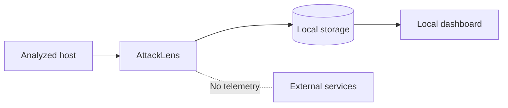

# Security Policy

## Overview

AttackLens is a local security analysis tool designed to analyze machines controlled by the user.

The scanner may access sensitive information about the analyzed host. Security and privacy are therefore considered core requirements of the project.

## Security principles

AttackLens follows these principles:

* Security data remains local by default.
* No telemetry is enabled by default.
* No credentials or secrets are collected unnecessarily.
* The scanner does not require root privileges by default.
* The dashboard does not require privileged access to the host.
* Host access should be explicitly justified and minimized.
* Findings should be supported by observable evidence.
* External services are not required for the core analysis.

## Data handling

AttackLens may collect information such as:

* Network interfaces
* Listening ports
* Running processes
* Installed packages
* Running services
* Container metadata
* Security configuration
* User and permission information

This information can be sensitive.

The project therefore follows a local-first architecture:



No collected security information should be transmitted externally by default.

Two features send data to third parties. Both are disabled until you configure them:

* `ATTACKLENS_ENABLE_OSV` sends package names and versions to the public OSV database,
  CVE identifiers to EPSS, and downloads the CISA KEV catalog.
* `ATTACKLENS_ALERT_WEBHOOK_URL` sends the target name and finding titles to your webhook.

Network scans read service banners over TLS without validating certificates, because
a scanner has to identify services that use self-signed certificates. These connections
only send an anonymous `HEAD` request, and their answer is only displayed as a banner.

## Host agent

The agent only makes outbound calls to the API, so nothing has to reach into the host.
It accepts a single kind of order, a network scan. It never executes a command received
from the API, and validates scan targets itself. `ATTACKLENS_ALLOWED_TARGETS` restricts
the targets the dashboard can send it.

Each agent has its own token, obtained with a one-time code that expires after 15
minutes. Tokens and codes are stored hashed. The name of an agent comes from its token,
never from its requests, and an agent can only report on itself: a compromised agent
cannot declare another enrolled machine clean. Set `ATTACKLENS_API_KEY`, otherwise
whoever reaches the API can create enrollment codes.

Agents run with the rights of the user, never as `SYSTEM` or root. The agent drops the
arguments of autostart entries, which can hold secrets, and keeps only the program path.

## Active checks

Network scans send one harmless request to a few services, listed in the README. They
never attempt authentication, never send a payload, and change nothing on the target.
They are still traffic: only scan systems you own or are authorized to assess.

## Audit trail

Scan orders, triage decisions, enrollments, revocations, refused reports, and generated
reports are recorded with their actor. Accepted risks expire, and reopen when the
finding changes. In audit mode, scans outside the scope of an active engagement are
refused, based on the resolved address of the target.

## Privilege model

AttackLens should follow the principle of least privilege.

The scanner should run as an unprivileged user whenever possible.

The following approach is intentionally avoided:

```text
sudo attacklens
```

for the entire application.

If a future feature genuinely requires additional privileges, the access mechanism must be narrowly scoped and documented.

## Sensitive information

AttackLens should avoid collecting:

* Passwords
* Private keys
* Authentication tokens
* API keys
* Session cookies
* Secret values

When configuration files contain sensitive information, the scanner should collect only the metadata required for the security analysis and redact sensitive values.

## Reporting a vulnerability

If you discover a security vulnerability in AttackLens, please report it privately to the project maintainers rather than opening a public issue.

A report should include:

* A description of the vulnerability
* Steps to reproduce it
* The affected component
* The potential security impact
* Suggested mitigation, if available

Do not include real credentials, private keys, personal data, or other sensitive information in vulnerability reports.
