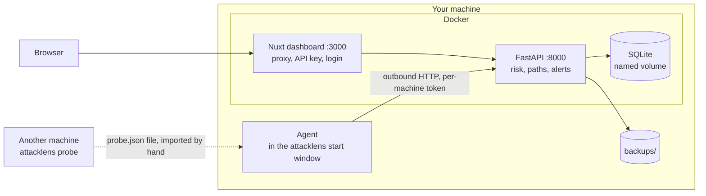

# AttackLens architecture decisions

This folder explains **why** AttackLens is built the way it is: what was chosen, what was
rejected, and what will need another look. For usage, see the [README](../../README.md). For the
security policy, see [SECURITY.md](../../SECURITY.md).

An ADR is not rewritten: if a decision changes, a new ADR replaces it and the old one moves to
`Superseded`.

## Overview

## Constraints behind the decisions

- **One user, on demand.** AttackLens runs when it is started, and never otherwise.
- **Local first.** No data leaves without explicit configuration.
- **Tell the truth.** What was not observed is never presented as safe.
- **Least privilege.** Nothing runs as administrator, `SYSTEM` or root.
- **Few moving parts.** One person must be able to understand and maintain all of it.
- **English throughout.** Code, interface and documentation are written in English.

## Index

| ADR | Decision | Status |
| --- | --- | --- |
| [0001](0001-api-and-dashboard-in-docker-agent-on-host.md) | API and dashboard in Docker, agent on the host | Accepted |
| [0002](0002-agent-driven-by-outbound-calls.md) | Agent driven by outbound calls | Accepted |
| [0003](0003-on-demand-execution.md) | On-demand execution, no background process | Accepted |
| [0004](0004-sqlite-owned-by-the-api.md) | SQLite owned by the API alone | Accepted |
| [0005](0005-three-views-and-a-reachability-verdict.md) | Three views and a reachability verdict | Accepted |
| [0006](0006-explainable-risk-model.md) | Explainable risk model | Accepted |
| [0007](0007-non-invasive-active-checks.md) | Non-invasive active checks, written in-house | Accepted |
| [0008](0008-per-agent-identity.md) | One identity per agent, through enrollment | Accepted |
| [0009](0009-nuxt-proxy-and-authentication.md) | Nuxt proxy, server-side API key, optional login | Accepted |
| [0010](0010-external-services-by-consent.md) | External services by explicit consent | Accepted |
| [0011](0011-finding-lifecycle.md) | Finding and alert lifecycle | Accepted |
| [0012](0012-rule-based-attack-paths.md) | Attack paths from explicit rules | Accepted |
| [0013](0013-supply-chain.md) | Locked supply chain | Accepted |
| [0014](0014-optical-bench-interface.md) | Interface: the optical bench | Accepted, visual language superseded by 0017 |
| [0015](0015-minimal-audit-mode.md) | Minimal audit mode | Accepted |
| [0016](0016-backups-and-retention.md) | Off-volume backups and retention | Accepted |
| [0017](0017-monochrome-and-vermilion.md) | Visual language: monochrome and vermilion | Accepted, visual language superseded by 0018 |
| [0018](0018-instrument-interface.md) | Interface as a measuring instrument | Accepted |

## Known weaknesses

Each one is detailed in the ADR concerned. In order of importance:

| # | Weakness | Consequence | ADR |
| --- | --- | --- | --- |
| 1 | No probe has run from a real second machine yet | Paths stay `potential` | [0005](0005-three-views-and-a-reachability-verdict.md) |
| 2 | A second machine cannot reach the API, bound to `127.0.0.1` and without TLS | Multi-machine use is not ready | [0002](0002-agent-driven-by-outbound-calls.md) |
| 3 | Without `ATTACKLENS_API_KEY`, any local process can create an enrollment code | The key is required in practice | [0008](0008-per-agent-identity.md) |
| 4 | The report cites the most recent engagement without checking its target or dates | Risk of a misleading audit report | [0015](0015-minimal-audit-mode.md) |
| 5 | An SQLite error during a backup escapes the `except OSError` | No more backups or silence alerts until the API restarts | [0016](0016-backups-and-retention.md) |
| 6 | The database is not encrypted at rest | Depends on disk encryption | [0004](0004-sqlite-owned-by-the-api.md) |
| 7 | The Python build backend is not locked by `requirements.lock` | Minor gap in the chain | [0013](0013-supply-chain.md) |
| 8 | Posture only covers Windows | Linux gets a poorer view | [0005](0005-three-views-and-a-reachability-verdict.md) |
| 9 | Nmap and Trivy are not integrated | Network coverage limited to 36 TCP ports | [0007](0007-non-invasive-active-checks.md) |

## What to revisit, and when

| If... | Then revisit |
| --- | --- |
| A second machine must report its data | 0002, 0008, 0009 |
| Several people use the dashboard | 0009 |
| AttackLens is used for real clients | 0004, 0009, 0015 |
| Several dozen machines | 0002, 0004 |
| Continuous monitoring becomes necessary again | 0003 |
